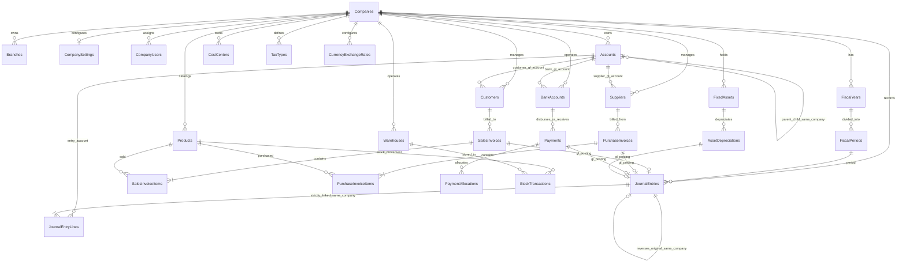

# تصميم قاعدة البيانات الشامل للنظام المحاسبي المتكامل (Enterprise Accounting ERP - Database Specification v4.0)

هذا المستند يمثل المرجع الهندسي والمحاسبي المعتمد لقاعدة بيانات نظام **AccountingERP**، والذي يغطي 35 جدولاً تغطي كافة الموديولات المحاسبية والتجارية وسلاسل الإمداد وإدارة الأصول والخزينة، مع تطبيق العزل التام للشركات (Multi-Tenancy) وحماية النزاهة المحاسبية.

---

## فهرس المجموعات والجداول (35 جدولاً)

1. **المجموعة 1: الهيكل التنظيمي والمستأجرين والهوية (Organization & Identity)**
   - `Companies` (الشركات)
   - `CompanySettings` (إعدادات الربط المحاسبي والنظامي للشركة)
   - `Branches` (الفروع)
   - `Users` (المستخدمين - Identity)
   - `Roles` (الأدوار)
   - `Permissions` (الصلاحيات الدقيقة)
   - `CompanyUsers` (صلاحيات المستخدمين على مستوى الشركات)

2. **المجموعة 2: البيانات التأسيسية والعملات والضرائب (Master Data, Currencies & Taxes)**
   - `Countries` (الدول)
   - `Currencies` (العملات)
   - `ExchangeRates` (أسعار الصرف التاريخية)
   - `TaxTypes` (أنواع الضرائب)
   - `TaxRates` (نسب الضرائب وتواريخ سريانها)

3. **المجموعة 3: الأستاذ العام ودفتر اليومية (General Ledger & Journal Entries)**
   - `Accounts` (دليل الحسابات الشجري)
   - `FiscalYears` (السنوات المالية)
   - `FiscalPeriods` (الفترات المالية وفترة التسويات 13)
   - `JournalEntries` (رأس قيد اليومية)
   - `JournalEntryLines` (أسطر القيد المزدوج)
   - `CostCenters` (مراكز التكلفة الشجرية)
   - `DocumentSequences` (التسلسل الصارم غير المنقطع Gapless)

4. **المجموعة 4: الشركاء والمبيعات والمشتريات (Commercial & Sub-Ledger)**
   - `Customers` (العملاء)
   - `Suppliers` (الموردين)
   - `SalesInvoices` (فواتير المبيعات)
   - `SalesInvoiceItems` (بنود فواتير المبيعات)
   - `PurchaseInvoices` (فواتير المشتريات)
   - `PurchaseInvoiceItems` (بنود فواتير المشتريات)
   - `Payments` (سندات القبض والصرف)
   - `PaymentAllocations` (تخصيص السدادات على الفواتير)

5. **المجموعة 5: الصندوق والبنوك (Treasury & Cash Management)**
   - `BankAccounts` (الحسابات البنكية والخزائن النقدية)
   - `BankReconciliations` (مذكرات التسوية البنكية)

6. **المجموعة 6: المخزون والمستودعات (Inventory & Warehousing)**
   - `Products` (الأصناف والمنتجات والخدمات)
   - `Warehouses` (المستودعات)
   - `StockTransactions` (حركات المخزون الوارد والمنصرف والتحويل)

7. **المجموعة 7: الأصول الثابتة والإهلاك (Fixed Assets & Depreciation)**
   - `FixedAssets` (الأصول الثابتة)
   - `AssetDepreciations` (سجلات وجداول إهلاك الأصول)

8. **المجموعة 8: الرقابة والتدقيق والمرفقات (Audit & System Infrastructure)**
   - `AuditLogs` (سجل التدقيق والرقابة المحاسبية)
   - `Attachments` (المرفقات والمستندات المؤيدة)

---

## تفاصيل الجداول الفنية الكاملة

---

### المجموعة 1: الهيكل التنظيمي والمستأجرين والهوية

#### 1. جدول الشركات (`Companies`)
* **الوظيفة:** يمثل الكيان الأعلى (Tenant) في النظام المحاسبي.
| الحقل | النوع | القيود | الوصف |
| :--- | :--- | :--- | :--- |
| `Id` | `int` | PK, Identity(1,1) | المعرف الفريد للشركة |
| `Code` | `nvarchar(20)` | Not Null | كود الشركة |
| `NameAr` | `nvarchar(150)` | Not Null | الاسم بالعربية |
| `NameEn` | `nvarchar(150)` | Not Null | الاسم بالإنجليزية |
| `TaxNumber` | `nvarchar(50)` | Nullable | الرقم الضريبي (VAT ID) |
| `CommercialRegistration` | `nvarchar(50)` | Nullable | رقم السجل التجاري |
| `CountryId` | `int` | FK -> `Countries(Id)` ON DELETE NO ACTION | الدولة |
| `BaseCurrencyId` | `int` | FK -> `Currencies(Id)` ON DELETE NO ACTION | عملة الأساس المحاسبية |
| `LogoUrl` | `nvarchar(500)` | Nullable | مسار الشعار |
| `Address` | `nvarchar(250)` | Nullable | العنوان |
| `Phone` | `nvarchar(50)` | Nullable | الهاتف |
| `Email` | `nvarchar(100)` | Nullable | البريد |
| `IsActive` | `bit` | Default 1 | التفعيل |
| `IsDeleted` | `bit` | Default 0 | الحذف الناعم |
| `CreatedAt` | `datetime2` | Default GETUTCDATE() | تاريخ الإنشاء |
* **Unique Constraints:** `UQ_Companies_Code (Code) WHERE IsDeleted = 0`

#### 2. جدول الفروع (`Branches`)
* **الوظيفة:** الفروع التشغيلية التابعة لكل شركة.
| الحقل | النوع | القيود | الوصف |
| :--- | :--- | :--- | :--- |
| `Id` | `int` | PK, Identity(1,1) | المعرف الفريد |
| `CompanyId` | `int` | FK -> `Companies(Id)` ON DELETE NO ACTION | الشركة |
| `Code` | `nvarchar(20)` | Not Null | كود الفرع داخل الشركة |
| `NameAr` | `nvarchar(150)` | Not Null | الاسم بالعربية |
| `NameEn` | `nvarchar(150)` | Not Null | الاسم بالإنجليزية |
| `IsMainBranch` | `bit` | Default 0 | هل هو الفرع الرئيسي؟ |
| `Address` | `nvarchar(250)` | Nullable | العنوان |
| `Phone` | `nvarchar(50)` | Nullable | الهاتف |
| `IsActive` | `bit` | Default 1 | التفعيل |
| `IsDeleted` | `bit` | Default 0 | الحذف الناعم |
* **Unique Constraints:**
  * `UQ_Branches_Company_Code (CompanyId, Code) WHERE IsDeleted = 0`
  * `UQ_Branches_Company_Id (CompanyId, Id)` *(لتمكين Composite FKs في كافة حركات الفروع)*

#### 3. جدول إعدادات الحسابات النظامية للشركة (`CompanySettings`)
* **الوظيفة:** ربط الحسابات الافتراضية للنظام لكل شركة لتوجيه العمليات الآلية دون تدخل بشري.
| الحقل | النوع | القيود | الوصف |
| :--- | :--- | :--- | :--- |
| `Id` | `int` | PK | المعرف |
| `CompanyId` | `int` | FK -> `Companies(Id)`, Unique | الشركة (1 إلى 1) |
| `RetainedEarningsAccountId` | `int` | Not Null | حساب الأرباح المبقاة لإقفال السنة المالية |
| `CurrentYearEarningsAccountId` | `int` | Not Null | حساب أرباح/خسائر العام الحالي |
| `ForexGainLossAccountId` | `int` | Not Null | حساب فروق تقييم العملات الأجنبية |
| `DefaultVatAccountId` | `int` | Nullable | حساب وسيط ضريبة القيمة المضافة |
| `SalesRevenueAccountId` | `int` | Nullable | حساب إيرادات المبيعات الافتراضي |
| `PurchaseExpenseAccountId` | `int` | Nullable | حساب مصروف المشتريات الافتراضي |
| `InventoryAssetAccountId` | `int` | Nullable | حساب أصول المخزون الافتراضي |
| `CogsAccountId` | `int` | Nullable | حساب تكلفة البضاعة المباعة الافتراضي |
* **Composite Foreign Keys:**
  * `FOREIGN KEY (CompanyId, RetainedEarningsAccountId) REFERENCES Accounts(CompanyId, Id) ON DELETE NO ACTION`
  * `FOREIGN KEY (CompanyId, CurrentYearEarningsAccountId) REFERENCES Accounts(CompanyId, Id) ON DELETE NO ACTION`
  * `FOREIGN KEY (CompanyId, ForexGainLossAccountId) REFERENCES Accounts(CompanyId, Id) ON DELETE NO ACTION`

#### 4. جداول الهوية والصلاحيات (`Users`, `Roles`, `Permissions`, `CompanyUsers`)
* **`Users` (`ApplicationUsers`):** يرث من `IdentityUser`، يحتوي على `FullName`, `IsActive`, `CreatedOn`.
* **`Roles` (`ApplicationRoles`):** يرث من `IdentityRole` (أدوار النظام: SystemAdmin, CompanyAdmin, Accountant, Auditor, Cashier...).
* **`Permissions`:** جدول الصلاحيات الدقيقة (مثل `JournalEntries.Create`, `JournalEntries.Post`, `FiscalYear.Close`).
* **`CompanyUsers`:** جدول ربط المستخدمين بالشركات والفروع والأدوار الخاصة بكل مستخدم في كل شركة:
  * `Id` (`bigint`, PK)
  * `UserId` (`nvarchar(450)`, FK -> `Users(Id)`)
  * `CompanyId` (`int`, FK -> `Companies(Id)`)
  * `DefaultBranchId` (`int`, FK -> `Branches(Id)`)
  * `RoleId` (`nvarchar(450)`, FK -> `Roles(Id)`)
  * `IsActive` (`bit`, Default 1)
  * **Unique:** `UQ_CompanyUsers (UserId, CompanyId)`

---

### المجموعة 2: البيانات التأسيسية والعملات والضرائب

#### 5. جدول الدول (`Countries`)
* `Id` (`int`, PK), `Code` (`nvarchar(10)`, Unique), `NameAr`, `NameEn`, `PhoneCode`.

#### 6. جدول العملات (`Currencies`)
* `Id` (`int`, PK), `Code` (`nvarchar(5)`, Unique: ISO), `NameAr`, `NameEn`, `Symbol`, `DecimalPlaces` (Default 2), `IsActive`.
* **Check:** `CHECK (DecimalPlaces BETWEEN 0 AND 4)`.

#### 7. جدول أسعار الصرف التاريخية (`ExchangeRates`)
* `Id` (`bigint`, PK), `CompanyId` (`int`), `FromCurrencyId` (`int`), `ToCurrencyId` (`int`), `RateDate` (`date`), `Rate` (`decimal(18,6)`).
* **قاعدة السعر:** Direct Quotation ($1 \text{ Foreign} = \text{Rate} \times \text{Base Currency}$).
* **Unique:** `UQ_Rates_Company_From_To_Date (CompanyId, FromCurrencyId, ToCurrencyId, RateDate)`.
* **Check:** `CHECK (Rate > 0)`.

#### 8. جدول أنواع الضرائب (`TaxTypes`)
* **الوظيفة:** تعريف وعاء الضرائب المطبقة (ضريبة القيمة المضافة، ضريبة الاستقطاع، ضريبة الأرباح التجارية).
* `Id` (`int`, PK), `CompanyId` (`int`, FK -> `Companies(Id)`), `Code` (`nvarchar(20)`), `NameAr`, `NameEn`, `AccountId` (`int`), `IsActive` (`bit`).
* **Composite FK:** `(CompanyId, AccountId) -> Accounts(CompanyId, Id)`.

#### 9. جدول نسب الضرائب وتاريخ سريانها (`TaxRates`)
* **الوظيفة:** إدارة النسبة المئوية للضريبة وتاريخ بداية ونهاية تطبيقها لدعم التغيرات القانونية التشريعية.
* `Id` (`int`, PK), `CompanyId` (`int`), `TaxTypeId` (`int`, FK -> `TaxTypes(Id)`), `Rate` (`decimal(5,2)`), `EffectiveFrom` (`date`), `EffectiveTo` (`date`, Nullable).
* **Check:** `CHECK (Rate >= 0 AND Rate <= 100)`.

---

### المجموعة 3: الأستاذ العام ودفتر اليومية

#### 10. جدول شجرة دليل الحسابات (`Accounts`)
* `Id` (`int`, PK), `CompanyId` (`int`), `ParentAccountId` (`int`, Nullable), `AccountCode` (`nvarchar(30)`), `NameAr`, `NameEn`, `AccountType` (1: أصول، 2: خصوم، 3: حقوق ملكية، 4: إيرادات، 5: مصروفات), `Nature` (1: مدين Debit، 2: دائن Credit), `Level` (`int`), `IsPosting` (`bit`), `CurrencyId` (`int`, Nullable), `IsActive`, `IsDeleted`.
* **Composite Self-FK:** `(CompanyId, ParentAccountId) -> Accounts(CompanyId, Id) ON DELETE NO ACTION`.
* **Unique:**
  * `UQ_Accounts_Company_Code (CompanyId, AccountCode) WHERE IsDeleted = 0`
  * `UQ_Accounts_Company_Id (CompanyId, Id)` *(لتمكين Composite FKs في كافة الجداول المالية والتجارية)*.

#### 11. جدول السنوات المالية (`FiscalYears`)
* `Id` (`int`, PK), `CompanyId` (`int`), `Name` (`nvarchar(50)`), `StartDate` (`date`), `EndDate` (`date`), `IsClosed` (`bit`), `ClosedAt` (`datetime2`, Nullable), `ClosedByUserId`, `ClosingJournalEntryId` (`bigint`, Nullable), `RowVersion` (`rowversion`).
* **Composite FK:** `(CompanyId, ClosingJournalEntryId) -> JournalEntries(CompanyId, Id)`.
* **Unique:** `UQ_FiscalYears_Company_Name (CompanyId, Name)`.
* **Check:** `CHECK (EndDate >= StartDate)`.

#### 12. جدول الفترات المالية وفترة التسويات (`FiscalPeriods`)
* `Id` (`int`, PK), `CompanyId` (`int`), `FiscalYearId` (`int`), `PeriodNumber` (`int`, 1..13), `PeriodType` (1: Regular, 2: YearEndAdjustment), `NameAr`, `NameEn`, `StartDate`, `EndDate`, `Status` (1: Open, 2: Closed, 3: Locked).
* **Unique:**
  * `UQ_Periods_Company_Year_Number (CompanyId, FiscalYearId, PeriodNumber)`
  * `UQ_Periods_Company_Id (CompanyId, Id)` *(قيد مركب أساسي لربط القيود)*.
* **Check:** `CHECK (EndDate >= StartDate)`, `CHECK (PeriodNumber BETWEEN 1 AND 13)`.

#### 13. جدول الترقيم التسلسلي الصارم غير المنقطع (`DocumentSequences`)
* **الوظيفة:** ضمان الترقيم المحاسبي المتسلسل الصارم دون فجوات (Gapless Sequential Numbering) لقيود اليومية والفواتير عند الترحيل فقط.
* `Id` (`int`, PK), `CompanyId` (`int`), `FiscalYearId` (`int`), `DocumentType` (`int`), `Prefix` (`nvarchar(10)`), `LastNumber` (`bigint`, Default 0).
* **Unique:** `UQ_DocSequences (CompanyId, FiscalYearId, DocumentType)`.

#### 14. جدول رأس قيد اليومية (`JournalEntries`)
* `Id` (`bigint`, PK), `CompanyId` (`int`), `BranchId` (`int`), `FiscalPeriodId` (`int`), `EntryNumber` (`nvarchar(50)`), `EntryDate` (`date`), `ReferenceNumber`, `Description` (`nvarchar(500)`), `EntryType` (1: Manual, 2: OpeningBalance, 3: Closing, 4: Reversal), `Status` (1: Draft, 2: Posted, 3: Reversed), `TotalDebit` (`decimal(18,4)`), `TotalCredit` (`decimal(18,4)`), `PostedAt`, `PostedByUserId`, `IsReversed` (`bit`, Default 0), `ReversedEntryId` (`bigint`, Nullable), `SourceDocumentType` (`int`, Nullable), `SourceDocumentId` (`nvarchar(100)`, Nullable), `RowVersion` (`rowversion`).
* **Composite Foreign Keys:**
  * `(CompanyId, BranchId) -> Branches(CompanyId, Id) ON DELETE NO ACTION`
  * `(CompanyId, FiscalPeriodId) -> FiscalPeriods(CompanyId, Id) ON DELETE NO ACTION`
  * `(CompanyId, ReversedEntryId) -> JournalEntries(CompanyId, Id) ON DELETE NO ACTION`
* **Unique Constraints:**
  * `UQ_JournalEntries_Company_Number (CompanyId, EntryNumber)`
  * `UQ_JournalEntries_Company_Id (CompanyId, Id)` *(لتمكين Composite FK مع أسطر القيد)*
  * `UQ_JournalEntries_ReversedEntryId (CompanyId, ReversedEntryId) WHERE ReversedEntryId IS NOT NULL` *(منع عكس القيد مرتين نهائياً)*
  * `UQ_JournalEntries_SourceDoc (CompanyId, SourceDocumentType, SourceDocumentId) WHERE SourceDocumentId IS NOT NULL` *(منع تكرار ترحيل الفاتورة نفسها)*
* **Check Constraints:**
  * `CHECK (TotalDebit >= 0 AND TotalCredit >= 0)`
  * `CHECK (NOT (EntryType = 4 AND ReversedEntryId IS NULL))`

#### 15. جدول أسطر قيد اليومية (`JournalEntryLines`)
* `Id` (`bigint`, PK), `JournalEntryId` (`bigint`), `CompanyId` (`int`), `BranchId` (`int`), `AccountId` (`int`), `LineNumber` (`int`), `Description`, `Debit` (`decimal(18,4)`), `Credit` (`decimal(18,4)`), `ForeignCurrencyId` (`int`, Nullable), `ExchangeRate` (`decimal(18,6)`), `ForeignDebit` (`decimal(18,4)`), `ForeignCredit` (`decimal(18,4)`), `CostCenterId` (`int`, Nullable).
* **Composite Foreign Keys:**
  * `(CompanyId, JournalEntryId) -> JournalEntries(CompanyId, Id) ON DELETE NO ACTION` *(إلغاء Cascade Delete)*
  * `(CompanyId, AccountId) -> Accounts(CompanyId, Id) ON DELETE NO ACTION`
* **Check Constraints:**
  * `CHECK (Debit >= 0 AND Credit >= 0 AND ((Debit > 0 AND Credit = 0) OR (Credit > 0 AND Debit = 0)))`
  * `CHECK (ExchangeRate > 0)`

#### 16. جدول مراكز التكلفة (`CostCenters`)
* `Id` (`int`, PK), `CompanyId` (`int`), `ParentCostCenterId` (`int`, Nullable), `Code`, `NameAr`, `NameEn`, `Level`, `IsActive`, `IsDeleted`.
* **Composite Self-FK:** `(CompanyId, ParentCostCenterId) -> CostCenters(CompanyId, Id) ON DELETE NO ACTION`.
* **Unique:** `UQ_CostCenters_Company_Code (CompanyId, Code) WHERE IsDeleted = 0`.

---

### المجموعة 4: الشركاء والمبيعات والمشتريات

#### 17. جدول العملاء (`Customers`)
* `Id` (`int`, PK), `CompanyId` (`int`), `Code` (`nvarchar(30)`), `NameAr`, `NameEn`, `TaxNumber`, `AccountId` (`int`), `CreditLimit` (`decimal(18,4)`), `Phone`, `Email`, `Address`, `IsActive`, `IsDeleted`.
* **Composite FK:** `(CompanyId, AccountId) -> Accounts(CompanyId, Id) ON DELETE NO ACTION`.
* **Unique:** `UQ_Customers_Company_Code (CompanyId, Code) WHERE IsDeleted = 0`.

#### 18. جدول الموردين (`Suppliers`)
* `Id` (`int`, PK), `CompanyId` (`int`), `Code` (`nvarchar(30)`), `NameAr`, `NameEn`, `TaxNumber`, `AccountId` (`int`), `Phone`, `Email`, `Address`, `IsActive`, `IsDeleted`.
* **Composite FK:** `(CompanyId, AccountId) -> Accounts(CompanyId, Id) ON DELETE NO ACTION`.
* **Unique:** `UQ_Suppliers_Company_Code (CompanyId, Code) WHERE IsDeleted = 0`.

#### 19. جدول فواتير المبيعات (`SalesInvoices`)
* `Id` (`bigint`, PK), `CompanyId` (`int`), `BranchId` (`int`), `InvoiceNumber` (`nvarchar(50)`), `InvoiceDate` (`date`), `DueDate` (`date`), `CustomerId` (`int`), `CurrencyId` (`int`), `ExchangeRate` (`decimal(18,6)`), `SubTotal` (`decimal(18,4)`), `TaxTotal` (`decimal(18,4)`), `DiscountTotal` (`decimal(18,4)`), `GrandTotal` (`decimal(18,4)`), `PaidAmount` (`decimal(18,4)`), `RemainingAmount` (`decimal(18,4)`), `Status` (1: Draft, 2: Approved, 3: PostedToGL, 4: Paid, 5: Cancelled), `JournalEntryId` (`bigint`, Nullable), `RowVersion` (`rowversion`).
* **Composite FKs:**
  * `(CompanyId, BranchId) -> Branches(CompanyId, Id) ON DELETE NO ACTION`
  * `(CompanyId, JournalEntryId) -> JournalEntries(CompanyId, Id) ON DELETE NO ACTION`
* **Unique:** `UQ_SalesInvoices_Number (CompanyId, InvoiceNumber)`.

#### 20. جدول بنود فواتير المبيعات (`SalesInvoiceItems`)
* `Id` (`bigint`, PK), `SalesInvoiceId` (`bigint`), `ProductId` (`int`), `WarehouseId` (`int`), `Quantity` (`decimal(18,4)`), `UnitPrice` (`decimal(18,4)`), `DiscountRate` (`decimal(5,2)`), `TaxTypeId` (`int`), `TaxRate` (`decimal(5,2)`), `TaxAmount` (`decimal(18,4)`), `LineTotal` (`decimal(18,4)`).
* **FKs:** `FK -> SalesInvoices(Id) ON DELETE CASCADE` (حذف البنود تابع لحذف مسودة الفاتورة فقط).

#### 21. جدول فواتير المشتريات (`PurchaseInvoices`)
* `Id` (`bigint`, PK), `CompanyId` (`int`), `BranchId` (`int`), `InvoiceNumber` (`nvarchar(50)`), `VendorBillNumber` (`nvarchar(100)`), `InvoiceDate` (`date`), `DueDate` (`date`), `SupplierId` (`int`), `CurrencyId` (`int`), `ExchangeRate` (`decimal(18,6)`), `SubTotal` (`decimal(18,4)`), `TaxTotal` (`decimal(18,4)`), `GrandTotal` (`decimal(18,4)`), `PaidAmount` (`decimal(18,4)`), `RemainingAmount` (`decimal(18,4)`), `Status` (1: Draft, 2: Approved, 3: PostedToGL, 4: Paid, 5: Cancelled), `JournalEntryId` (`bigint`, Nullable), `RowVersion` (`rowversion`).
* **Unique:** `UQ_PurchaseInvoices_Number (CompanyId, InvoiceNumber)`.

#### 22. جدول بنود فواتير المشتريات (`PurchaseInvoiceItems`)
* `Id` (`bigint`, PK), `PurchaseInvoiceId` (`bigint`), `ProductId` (`int`), `WarehouseId` (`int`), `Quantity` (`decimal(18,4)`), `UnitPrice` (`decimal(18,4)`), `TaxAmount` (`decimal(18,4)`), `LineTotal` (`decimal(18,4)`).

#### 23. جدول سندات القبض والصرف (`Payments`)
* **الوظيفة:** إدارة المدفوعات والمقبوضات النقدية والبنكية والشيكات.
* `Id` (`bigint`, PK), `CompanyId` (`int`), `BranchId` (`int`), `PaymentNumber` (`nvarchar(50)`), `PaymentType` (1: سند قبض Receipt, 2: سند صرف Payment), `PaymentMethod` (1: Cash, 2: BankTransfer, 3: Cheque), `PaymentDate` (`date`), `BankAccountId` (`int`), `CustomerId` (`int`, Nullable), `SupplierId` (`int`, Nullable), `Amount` (`decimal(18,4)`), `CurrencyId` (`int`), `ExchangeRate` (`decimal(18,6)`), `BaseAmount` (`decimal(18,4)`), `ReferenceNumber`, `ChequeNumber`, `ChequeDueDate`, `Status` (1: Draft, 2: PostedToGL, 3: Cancelled), `JournalEntryId` (`bigint`, Nullable).
* **Composite FKs:** `(CompanyId, JournalEntryId) -> JournalEntries(CompanyId, Id)`.
* **Unique:** `UQ_Payments_Number (CompanyId, PaymentNumber)`.

#### 24. جدول تخصيص السدادات على الفواتير (`PaymentAllocations`)
* **الوظيفة:** ربط مبلغ السند بالفاتورة المحددة لإقفال الذمم وتحديث الرصيد المتبقي.
* `Id` (`bigint`, PK), `PaymentId` (`bigint`, FK -> `Payments(Id)`), `SalesInvoiceId` (`bigint`, Nullable, FK -> `SalesInvoices(Id)`), `PurchaseInvoiceId` (`bigint`, Nullable, FK -> `PurchaseInvoices(Id)`), `AllocatedAmount` (`decimal(18,4)`).

---

### المجموعة 5: الصندوق والبنوك

#### 25. جدول الحسابات البنكية والخزائن (`BankAccounts`)
* `Id` (`int`, PK), `CompanyId` (`int`), `BranchId` (`int`), `Code` (`nvarchar(30)`), `NameAr`, `NameEn`, `AccountNumber` (IBAN), `CurrencyId` (`int`), `AccountId` (`int`), `IsCash` (`bit`), `IsActive`.
* **Composite FK:** `(CompanyId, AccountId) -> Accounts(CompanyId, Id) ON DELETE NO ACTION`.
* **Unique:** `UQ_BankAccounts_Code (CompanyId, Code)`.

#### 26. جدول مذكرات التسوية البنكية (`BankReconciliations`)
* **الوظيفة:** مطابقة كشف الحساب البنكي مع رصيد الدفاتر المحاسبية.
* `Id` (`bigint`, PK), `CompanyId` (`int`), `BankAccountId` (`int`), `ReconciliationDate` (`date`), `StatementEndingBalance` (`decimal(18,4)`), `BookBalance` (`decimal(18,4)`), `Difference` (`decimal(18,4)`), `IsReconciled` (`bit`), `ReconciledAt` (`datetime2`, Nullable).

---

### المجموعة 6: المخزون والمستودعات

#### 27. جدول الأصناف والمنتجات (`Products`)
* `Id` (`int`, PK), `CompanyId` (`int`), `Code` (`nvarchar(50)`), `NameAr`, `NameEn`, `ProductType` (1: مخزني Storable, 2: خدمي Service, 3: استهلاكي Consumable), `Barcode` (`nvarchar(100)`, Nullable), `UnitName` (`nvarchar(30)`), `CostPrice` (`decimal(18,4)`), `SellingPrice` (`decimal(18,4)`), `InventoryAccountId` (`int`, Nullable), `CogsAccountId` (`int`, Nullable), `SalesAccountId` (`int`, Nullable), `IsActive`, `IsDeleted`.
* **Composite FKs:**
  * `(CompanyId, InventoryAccountId) -> Accounts(CompanyId, Id)`
  * `(CompanyId, CogsAccountId) -> Accounts(CompanyId, Id)`
  * `(CompanyId, SalesAccountId) -> Accounts(CompanyId, Id)`
* **Unique:** `UQ_Products_Code (CompanyId, Code) WHERE IsDeleted = 0`.

#### 28. جدول المستودعات (`Warehouses`)
* `Id` (`int`, PK), `CompanyId` (`int`), `BranchId` (`int`), `Code`, `NameAr`, `NameEn`, `Location`, `IsActive`, `IsDeleted`.
* **Unique:** `UQ_Warehouses_Code (CompanyId, Code) WHERE IsDeleted = 0`.

#### 29. جدول حركات المخزون (`StockTransactions`)
* **الوظيفة:** تسجيل الأثر الحركي للأصناف (إدخال، إخراج، تسوية جرد، تحويل بين المستودعات) مع التكلفة المتوسطة WAC.
* `Id` (`bigint`, PK), `CompanyId` (`int`), `WarehouseId` (`int`), `ProductId` (`int`), `TransactionType` (1: PurchaseIn, 2: SalesOut, 3: TransferIn, 4: TransferOut, 5: InventoryAdjustment), `TransactionDate` (`date`), `Quantity` (`decimal(18,4)`), `UnitCost` (`decimal(18,4)`), `TotalCost` (`decimal(18,4)`), `ReferenceDocumentType` (`int`), `ReferenceDocumentId` (`nvarchar(100)`), `JournalEntryId` (`bigint`, Nullable).

---

### المجموعة 7: الأصول الثابتة والإهلاك

#### 30. جدول الأصول الثابتة (`FixedAssets`)
* `Id` (`int`, PK), `CompanyId` (`int`), `BranchId` (`int`), `AssetCode` (`nvarchar(50)`), `NameAr`, `NameEn`, `PurchaseDate` (`date`), `PurchaseCost` (`decimal(18,4)`), `SalvageValue` (`decimal(18,4)`), `UsefulLifeMonths` (`int`), `DepreciationMethod` (1: StraightLine القسط الثابت), `AssetAccountId` (`int`), `AccumulatedDepreciationAccountId` (`int`), `DepreciationExpenseAccountId` (`int`), `Status` (1: Active, 2: Disposed, 3: FullyDepreciated).
* **Composite FKs:**
  * `(CompanyId, AssetAccountId) -> Accounts(CompanyId, Id)`
  * `(CompanyId, AccumulatedDepreciationAccountId) -> Accounts(CompanyId, Id)`
  * `(CompanyId, DepreciationExpenseAccountId) -> Accounts(CompanyId, Id)`
* **Unique:** `UQ_FixedAssets_Code (CompanyId, AssetCode)`.

#### 31. جدول سجلات وجداول إهلاك الأصول (`AssetDepreciations`)
* `Id` (`bigint`, PK), `CompanyId` (`int`), `FixedAssetId` (`int`), `FiscalPeriodId` (`int`), `DepreciationDate` (`date`), `DepreciationAmount` (`decimal(18,4)`), `BookValueAfterDepreciation` (`decimal(18,4)`), `JournalEntryId` (`bigint`, Nullable).

---

### المجموعة 8: الرقابة والتدقيق والمرفقات

#### 32. جدول سجل التدقيق والمراجعة (`AuditLogs`)
* `Id` (`bigint`, PK), `CompanyId` (`int`), `UserId` (`nvarchar(450)`), `Action` (`nvarchar(50)`), `EntityName` (`nvarchar(100)`), `EntityId` (`nvarchar(100)`), `OldValues` (`nvarchar(max)`), `NewValues` (`nvarchar(max)`), `Timestamp` (`datetime2`), `IpAddress` (`nvarchar(50)`).
* **Indexes:** `IX_AuditLogs_Company_Time (CompanyId, Timestamp DESC)`.

#### 33. جدول المرفقات والمستندات المؤيدة (`Attachments`)
* `Id` (`bigint`, PK), `CompanyId` (`int`), `EntityName` (`nvarchar(100)`), `EntityId` (`nvarchar(100)`), `FileName` (`nvarchar(255)`), `FileExtension` (`nvarchar(20)`), `FileSizeBytes` (`bigint`), `FilePath` (`nvarchar(500)`), `UploadedByUserId` (`nvarchar(450)`), `UploadedAt` (`datetime2`).

---

## مخطط العلاقات الكيانية الشامل (Enterprise Mermaid ERD)

